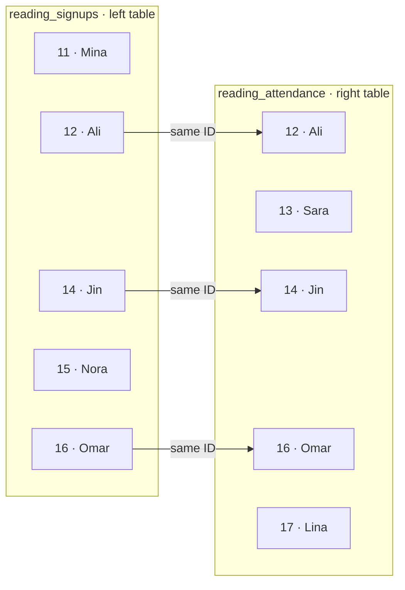
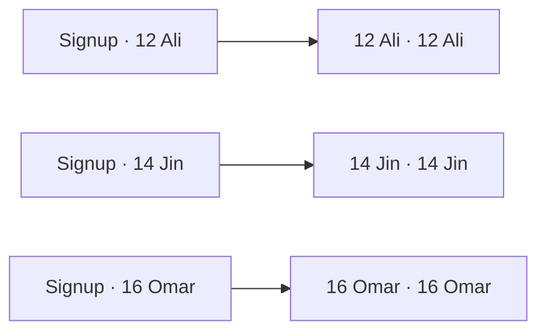
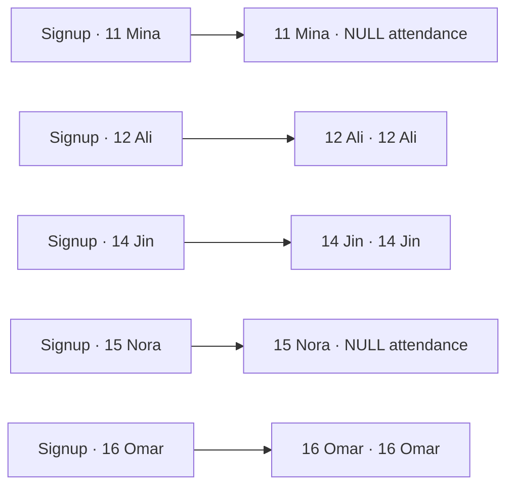
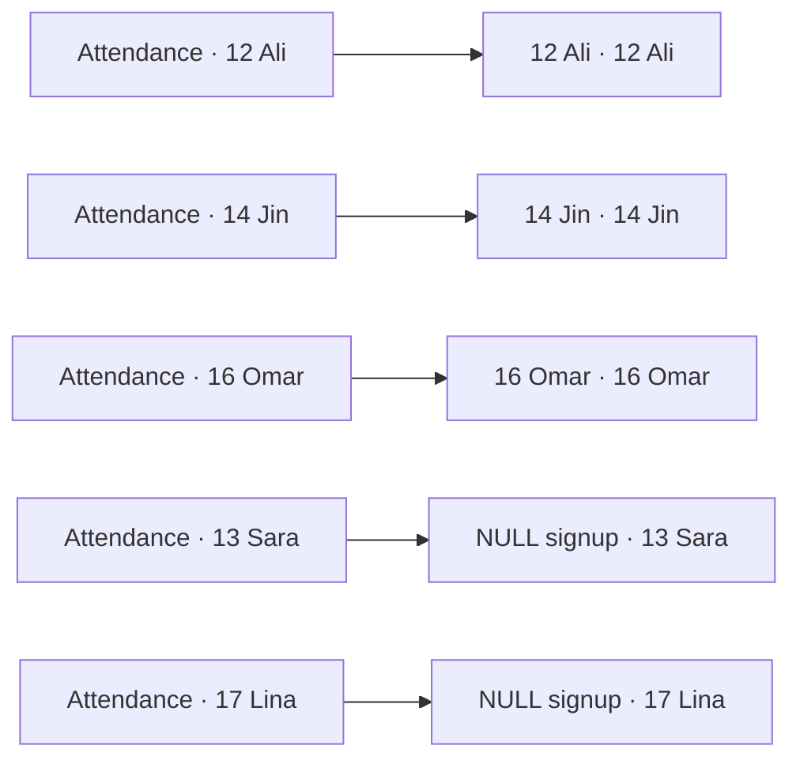
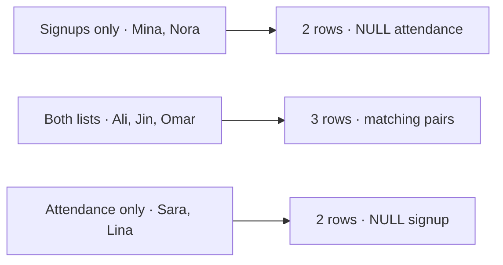
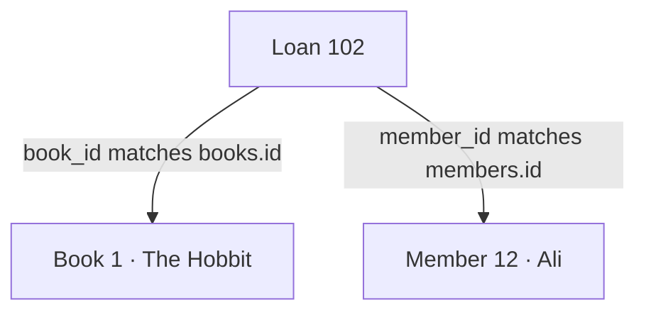
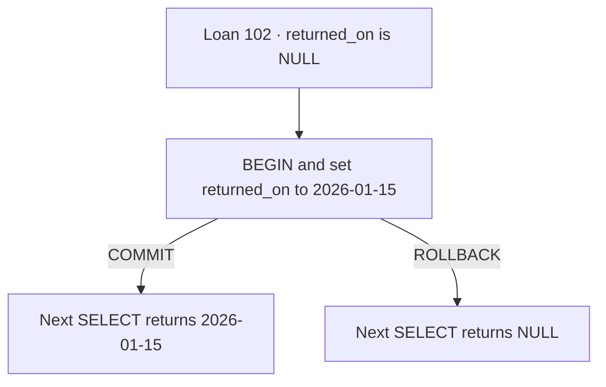
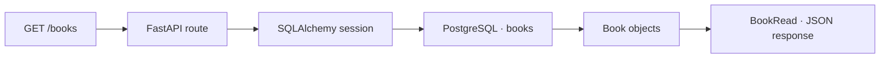

# Session 04 — Join, count, and roll back

[Week 02](README.md) · [Session 03](session-03.md) · [Open postgres.new](https://postgres.new/)

## What we’ll learn

- `INNER`, `LEFT`, `RIGHT`, and `FULL JOIN`
- `GROUP BY` and `COUNT`
- Transactions, `COMMIT`, and `ROLLBACK`
- SQLAlchemy preview

Learn each concept, see its result, then run the SQL in postgres.new.

## 1. What a join does

A join combines matching rows from two tables. `ON` specifies how to match them, such as equal member IDs.

For a library reading event, five people signed up and five people attended. The lists overlap, but some signups were absent and some attendees walked in.

**Signups — left table**

| member_id | member_name |
|---:|---|
| 11 | Mina |
| 12 | Ali |
| 14 | Jin |
| 15 | Nora |
| 16 | Omar |

**Attendance — right table**

| member_id | member_name |
|---:|---|
| 12 | Ali |
| 13 | Sara |
| 14 | Jin |
| 16 | Omar |
| 17 | Lina |

IDs `12`, `14`, and `16` match on both lists. Mina and Nora signed up but were absent. Sara and Lina attended without signing up.



In `FROM reading_signups JOIN reading_attendance`, signups is the **left table** and attendance is the **right table**. Match rows by ID. The join type determines which unmatched rows to keep.

## 2. The four join types

All four joins use `s.member_id = a.member_id`. A missing side of an output row is filled with `NULL`.

### INNER JOIN

**Keep matching pairs.** IDs `12`, `14`, and `16` appear in both tables, so the result has **3 rows**.

| signup_id | signed_up | attendance_id | attended |
|---:|---|---:|---|
| 12 | Ali | 12 | Ali |
| 14 | Jin | 14 | Jin |
| 16 | Omar | 16 | Omar |



### LEFT JOIN

**Keep every left row and its matches.** All five signups appear. Mina and Nora have no matching attendance, so their attendance columns are `NULL`. The result has **5 rows**.

| signup_id | signed_up | attendance_id | attended |
|---:|---|---:|---|
| 11 | Mina | `NULL` | `NULL` |
| 12 | Ali | 12 | Ali |
| 14 | Jin | 14 | Jin |
| 15 | Nora | `NULL` | `NULL` |
| 16 | Omar | 16 | Omar |



### RIGHT JOIN

**Keep every right row and its matches.** All five attendees appear. Sara and Lina have no matching signup, so their signup columns are `NULL`. The result has **5 rows**.

| signup_id | signed_up | attendance_id | attended |
|---:|---|---:|---|
| 12 | Ali | 12 | Ali |
| 14 | Jin | 14 | Jin |
| 16 | Omar | 16 | Omar |
| `NULL` | `NULL` | 13 | Sara |
| `NULL` | `NULL` | 17 | Lina |



### FULL JOIN

**Keep matching pairs and unmatched rows from both sides.** Combine the three matching pairs, two absent signups, and two walk-ins. The result has **7 rows**.

| signup_id | signed_up | attendance_id | attended |
|---:|---|---:|---|
| 11 | Mina | `NULL` | `NULL` |
| 12 | Ali | 12 | Ali |
| 14 | Jin | 14 | Jin |
| 15 | Nora | `NULL` | `NULL` |
| 16 | Omar | 16 | Omar |
| `NULL` | `NULL` | 13 | Sara |
| `NULL` | `NULL` | 17 | Lina |



| Report | Join | Rows | People in the result |
|---|---|---:|---|
| Signed up and attended | `INNER` | 3 | Ali, Jin, Omar |
| Every signup with attendance if present | `LEFT` | 5 | Mina, Ali, Jin, Nora, Omar |
| Every attendee with signup if present | `RIGHT` | 5 | Ali, Jin, Omar, Sara, Lina |
| Everyone on either list | `FULL` | 7 | Mina, Ali, Jin, Nora, Omar, Sara, Lina |

These counts follow from this dataset’s unique member IDs. Each ID matches at most one row on the other side. A join can produce more rows when one source row has multiple matches, as you’ll see with books and loans below.

## 3. Run the four SQL examples

Create these two small tables once in your current practice database. Keep each list independent so a walk-in attendee can be recorded.

```sql
CREATE TABLE reading_signups (
    member_id integer PRIMARY KEY,
    member_name text NOT NULL
);

CREATE TABLE reading_attendance (
    member_id integer PRIMARY KEY,
    member_name text NOT NULL
);

INSERT INTO reading_signups (member_id, member_name)
VALUES
    (11, 'Mina'),
    (12, 'Ali'),
    (14, 'Jin'),
    (15, 'Nora'),
    (16, 'Omar');

INSERT INTO reading_attendance (member_id, member_name)
VALUES
    (12, 'Ali'),
    (13, 'Sara'),
    (14, 'Jin'),
    (16, 'Omar'),
    (17, 'Lina');
```

`AS s` and `AS a` give the tables short names. `s.member_id` means the member ID from signups.

`SELECT` chooses the output columns, `ON` matches equal IDs, and `AS signup_id` names an output column. `JOIN` alone means `INNER JOIN`, and adding `OUTER` to `LEFT`, `RIGHT`, or `FULL JOIN` keeps the same meaning.

### INNER JOIN example

```sql
SELECT s.member_id AS signup_id, s.member_name AS signed_up,
       a.member_id AS attendance_id, a.member_name AS attended
FROM reading_signups AS s
INNER JOIN reading_attendance AS a ON s.member_id = a.member_id
ORDER BY s.member_id NULLS LAST, a.member_id;
```

### LEFT JOIN example

```sql
SELECT s.member_id AS signup_id, s.member_name AS signed_up,
       a.member_id AS attendance_id, a.member_name AS attended
FROM reading_signups AS s
LEFT JOIN reading_attendance AS a ON s.member_id = a.member_id
ORDER BY s.member_id NULLS LAST, a.member_id;
```

### RIGHT JOIN example

```sql
SELECT s.member_id AS signup_id, s.member_name AS signed_up,
       a.member_id AS attendance_id, a.member_name AS attended
FROM reading_signups AS s
RIGHT JOIN reading_attendance AS a ON s.member_id = a.member_id
ORDER BY s.member_id NULLS LAST, a.member_id;
```

### FULL JOIN example

```sql
SELECT s.member_id AS signup_id, s.member_name AS signed_up,
       a.member_id AS attendance_id, a.member_name AS attended
FROM reading_signups AS s
FULL JOIN reading_attendance AS a ON s.member_id = a.member_id
ORDER BY s.member_id NULLS LAST, a.member_id;
```

Run each query and compare it to the result table above. `NULLS LAST` puts missing signup IDs after known IDs when sorting.

**Practice.** Add `WHERE a.member_id IS NULL` to the left join before `ORDER BY` to find Mina and Nora, who were absent. Add `WHERE s.member_id IS NULL` to the right join to find Sara and Lina, who attended without signing up.

These examples follow PostgreSQL’s definitions of matching rows and outer joins. [PostgreSQL join definitions](https://www.postgresql.org/docs/current/queries-table-expressions.html#QUERIES-JOIN)

## 4. Apply an inner join to loans and books

Use the clean library data from Session 03 or load the [seed script](code/library.sql) into a fresh database. Each loan’s `book_id` matches a book’s `id`, so the join adds its title.

```sql
SELECT loans.id, books.title
FROM loans
INNER JOIN books ON loans.book_id = books.id
ORDER BY loans.id;
```

The result has one row per loan. *The Hobbit* appears twice because book `1` has two matching loans.

## 5. Add the borrower and keep only open loans

Join each loan to its member, then filter for a missing return date.

```sql
SELECT l.id, b.title, m.name AS borrower
FROM loans AS l
INNER JOIN books AS b ON l.book_id = b.id
INNER JOIN members AS m ON l.member_id = m.id
WHERE l.returned_on IS NULL
ORDER BY l.id;
```

`l.member_id = m.id` adds the borrower’s name. `WHERE l.returned_on IS NULL` keeps open loans.



The result is **loan `102`, The Hobbit, Ali**. Change the filter to show the full loan history for book `1`. You should see both Mina and Ali. [PostgreSQL joins](https://www.postgresql.org/docs/current/tutorial-join.html)

## 6. Count loans for every book, including zero

Start with books on the left to keep every book, including those with no loans.

```sql
SELECT b.id, b.title, l.id AS loan_id
FROM books AS b
LEFT JOIN loans AS l ON b.id = l.book_id
ORDER BY b.id, l.id;
```

The left join keeps *The Little Prince* even though it has no loan. Its `loan_id` is `NULL`.

| Book ID | Book title | Loan ID after `LEFT JOIN` |
|---:|---|---:|
| 1 | The Hobbit | `101` |
| 1 | The Hobbit | `102` |
| 2 | A Wizard of Earthsea | `103` |
| 3 | The Little Prince | `NULL` |

`GROUP BY` collects rows for the same book. `COUNT(l.id)` counts the loan IDs present in each group, producing one count per book.

```sql
SELECT b.id, b.title, COUNT(l.id) AS loan_count
FROM books AS b
LEFT JOIN loans AS l ON b.id = l.book_id
GROUP BY b.id, b.title
ORDER BY b.id;
```

| Book | Loan count |
|---|---:|
| The Hobbit | 2 |
| A Wizard of Earthsea | 1 |
| The Little Prince | 0 |

`COUNT(*)` counts result rows, so it gives *The Little Prince* `1`. `COUNT(l.id)` counts present loan IDs, so it gives that book `0`. [PostgreSQL aggregate functions](https://www.postgresql.org/docs/current/tutorial-agg.html)

## 7. Try a change in a transaction

A transaction groups database changes into one operation. `BEGIN` starts it, `COMMIT` saves its changes, and `ROLLBACK` undoes them.

Check the return date on loan `102` before the demo.

```sql
SELECT id, returned_on FROM loans WHERE id = 102;
```

Run this block together. Then run the `SELECT` again.

```sql
BEGIN;

UPDATE loans
SET returned_on = DATE '2026-01-15'
WHERE id = 102;

ROLLBACK;
```

After `ROLLBACK`, the return date is still `NULL`. Repeat the block using `COMMIT` to save `2026-01-15`.



After the demo, restore the open loan so the rest of the examples match the original data.

```sql
UPDATE loans SET returned_on = NULL WHERE id = 102;
```

**AI example.** Save a document and its chunks in one transaction. Commit after all writes succeed, or roll back if a write fails. [PostgreSQL transactions](https://www.postgresql.org/docs/current/tutorial-transactions.html)

## 8. Preview SQLAlchemy

SQLAlchemy lets Python describe and run database operations. Its ORM maps a table to a Python class and a row to an object. For example, a `Book` object has an `id` and a `title`, just like a row in `books`.

### Map the existing table

This class describes the `books` table we created with SQL.

```python
from sqlalchemy import Text, create_engine, select
from sqlalchemy.orm import DeclarativeBase, Mapped, Session, mapped_column


class Base(DeclarativeBase):
    pass


class Book(Base):
    __tablename__ = "books"

    id: Mapped[int] = mapped_column(primary_key=True)
    title: Mapped[str] = mapped_column(Text)
```

| Python | Database meaning |
|---|---|
| `Base` | The shared base class for our table mappings. |
| `__tablename__ = "books"` | Connect this class to the table named `books`. |
| `Mapped[int]` | This attribute maps to an integer column. |
| `mapped_column(primary_key=True)` | This column identifies a row. |
| `Mapped[str]` with `Text` | This attribute maps to a text column. |

The class describes the table. Our setup SQL has already created the table and inserted the rows. [SQLAlchemy model mapping](https://docs.sqlalchemy.org/en/20/orm/quickstart.html#declare-models)

### Connect and open a session

Run the Python examples in the [homework environment](code/README.md), using the existing library tables on the database named by `DATABASE_URL`.

```python
import os

engine = create_engine(os.environ["DATABASE_URL"])
```

The **engine** manages database connections. A **session** runs queries and tracks changes to mapped objects. `with Session(engine)` opens a session and closes it when the block ends.

### Read rows

The SQL below lists books in ID order.

```sql
SELECT id, title FROM books ORDER BY id;
```

SQLAlchemy expresses the same query in Python.

```python
statement = select(Book).order_by(Book.id)

with Session(engine) as session:
    books = session.scalars(statement).all()
    for book in books:
        print(book.id, book.title)
```

`select(Book)` selects mapped books, and `order_by(Book.id)` sorts them. `session.scalars(...).all()` executes the query and returns a list of `Book` objects. With fresh seed data, the first printed row is `1 The Hobbit`.

### Filter a query

```sql
SELECT id, title FROM books WHERE id = 1;
```

```python
statement = select(Book).where(Book.id == 1)

with Session(engine) as session:
    book = session.scalars(statement).one_or_none()
    if book is not None:
        print(book.title)
```

`where()` adds the filter. `one_or_none()` returns the matching book or `None` when no row matches. Here it returns *The Hobbit*. For a primary-key lookup, `session.get(Book, 1)` is a shorter equivalent.

### Write a row in a transaction

Run this insert once after loading the fresh seed data, where book ID `4` is available.

```sql
INSERT INTO books (id, title) VALUES (4, 'Python Basics');
```

```python
with Session(engine) as session:
    with session.begin():
        book = Book(id=4, title="Python Basics")
        session.add(book)
```

`Book(...)` creates the Python object, and `session.add(book)` marks it for insertion. The `session.begin()` block commits when it finishes successfully and rolls back if an exception occurs. Rerun the read example to see book `4` in PostgreSQL. [SQLAlchemy sessions and transactions](https://docs.sqlalchemy.org/en/20/orm/session_basics.html#framing-out-a-begin-commit-rollback-block)

### Use the session in FastAPI

The [homework starter](code/main.py) supplies `get_session` and `BookRead`. Its route uses the same query we just ran.

```python
@app.get("/books", response_model=list[BookRead])
def list_books(session: Annotated[Session, Depends(get_session)]):
    statement = select(Book).order_by(Book.id)
    return session.scalars(statement).all()
```

FastAPI gets a session through `Depends(get_session)`. SQLAlchemy retrieves the books, and the Pydantic `BookRead` schema defines the response fields. In the starter, `from_attributes=True` lets Pydantic read those fields from each `Book` object.



For homework, use SQLAlchemy to join library records, filter loans, and save a return inside a transaction. [SQLAlchemy ORM Quick Start](https://docs.sqlalchemy.org/en/20/orm/quickstart.html)

### Watch after class

Watch the selected video, then use the starter to identify the mapped model, engine, session, and query. Use the syntax shown in this lesson for your homework. [SQLAlchemy video](https://youtu.be/AKQ3XEDI9Mw)

## Practice

- Change the left join to keep attendance on the left, then confirm it returns all five attendees.
- Filter the full join to find people who appear on only one list.
- Run the loan-count query with both `COUNT(l.id)` and `COUNT(*)` and compare the counts.
- Update a return date inside a transaction, roll back, and check the date again.

For another dataset, try [SQLBolt’s first join exercise](https://sqlbolt.com/lesson/select_queries_with_joins). Continue with [Homework 04](assignment04.md).
